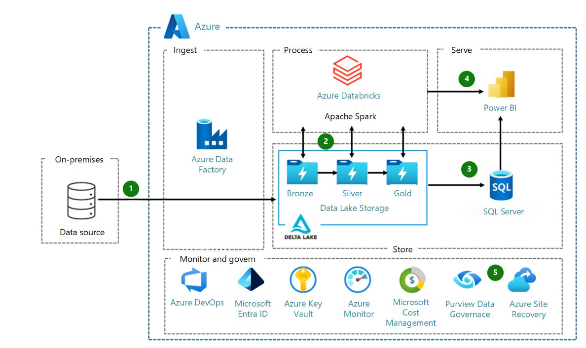
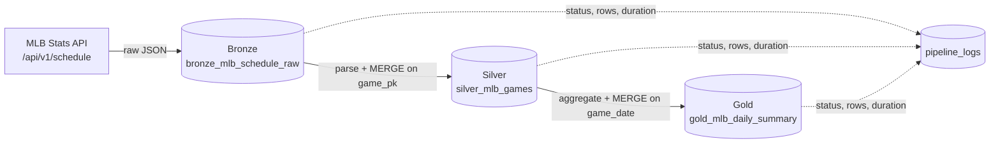
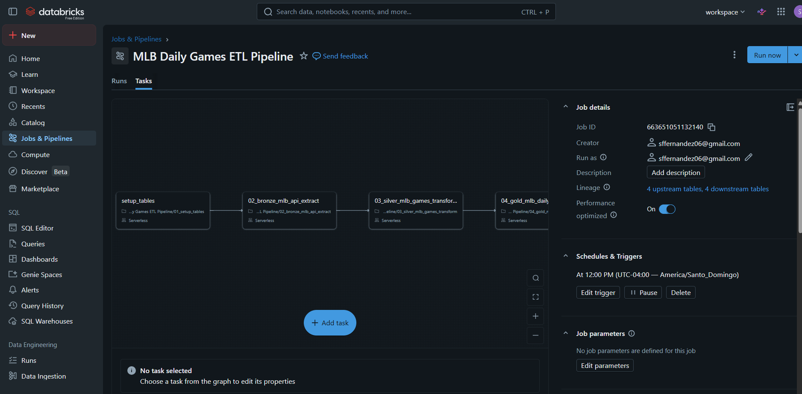

<p align="center">
  
</p>

# MLB Daily Games ETL Pipeline

An automated, end-to-end ETL pipeline on **Databricks** that ingests yesterday's MLB games from the public **MLB Stats API**, processes them through a **Bronze → Silver → Gold** Medallion Architecture on **Delta Lake**, and runs every night as a scheduled **Databricks Job**.

**Stack:** Python · PySpark · Spark SQL · Delta Lake (MERGE) · Databricks Jobs · REST API

▶️ **Video walkthrough:** https://youtu.be/oDlRG3iUFq8

---

## Business problem

Sports dashboards need fresh, reliable game results every morning. Pulling them by hand is slow and error-prone. This pipeline automates the daily load and delivers clean, analytics-ready tables plus an execution log to monitor every run.

## Architecture

<p align="center">
  
</p>



| Layer | Table | What it holds |
|---|---|---|
| Bronze | `mlb_project.bronze_mlb_schedule_raw` | The raw API response stored as JSON, with request URL, HTTP status, extraction time and run ID. Append-only for traceability. |
| Silver | `mlb_project.silver_mlb_games` | One row per game: date, season, game type, status, home/away teams and scores, venue, inning state and `is_final` flag. Upserted with `MERGE` on `game_pk`, so re-runs do not create duplicates. |
| Gold | `mlb_project.gold_mlb_daily_summary` | Daily KPIs: total games, final vs. non-final games, total runs, average runs per game and teams playing. Upserted with `MERGE` on `game_date`. |
| Logs | `mlb_project.pipeline_logs` | One record per layer and run: status (SUCCESS/FAILED), message, records processed, start/end time and duration in seconds. |

## How it works

1. **Setup** (`01_setup_tables.ipynb`) creates the `mlb_project` database, the three layer tables and the log table.
2. **Bronze** (`02_bronze_mlb_api_extract.ipynb`) calls `statsapi.mlb.com/api/v1/schedule` for the previous day (time zone `America/Santo_Domingo`), validates the HTTP status and appends the raw JSON.
3. **Silver** (`03_silver_mlb_games_transform.ipynb`) reads the latest Bronze record for the date, flattens the nested JSON into a typed schema and merges it into Silver.
4. **Gold** (`04_gold_mlb_daily_summary.ipynb`) checks that Silver has data for the date, aggregates the daily metrics and merges them into Gold.
5. **Validation** (`05_validation_queries.ipynb`) contains SQL checks for each layer, the run logs and row counts per layer.

Every step writes to `pipeline_logs`, and failures are logged with the full error before the task stops.

## Automation

<p align="center">
  
</p>

The four notebooks run as dependent tasks in a **Databricks Job** scheduled daily at **12:00 AM (America/Santo_Domingo)**, so each layer only runs after the previous one succeeds.

## Repository structure

```
├── 01_setup_tables.ipynb
├── 02_bronze_mlb_api_extract.ipynb
├── 03_silver_mlb_games_transform.ipynb
├── 04_gold_mlb_daily_summary.ipynb
├── 05_validation_queries.ipynb
├── medallion_architecture.png
├── WorkFlow.png
└── thumbnail.png
```

## Run it yourself

1. Import the notebooks into a Databricks workspace (Free Edition works).
2. Run `01_setup_tables` once.
3. Run notebooks 02 → 04 in order, or create a Job with these tasks and dependencies.
4. Use `05_validation_queries` to check each layer and the logs.

## Next steps

- Power BI report on top of the Gold table.
- Expectations / data-quality rules on the Silver layer.

---

**Stanly Fernández** · [LinkedIn](https://www.linkedin.com/in/stanly-fernandez/) · [Portfolio](https://stanly06.github.io/) · [GitHub](https://github.com/Stanly06)
