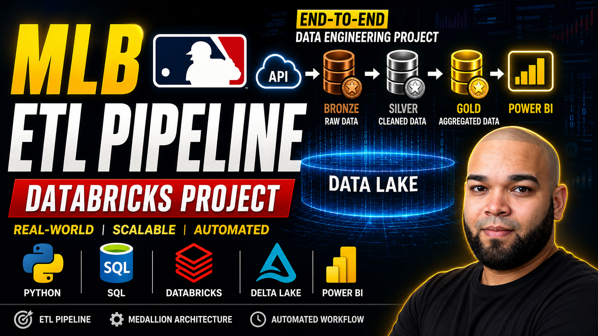
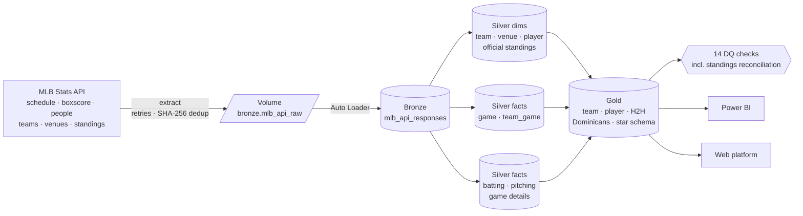

<p align="center">
  
</p>

# MLB Performance Intelligence Platform

An automated **Databricks Lakehouse** that turns the public **MLB Stats API** into answers analysts
actually need: *How is this player trending? Is this team as good as its record? Who won when these
two teams met? How are Dominican players performing?* Every regular-season and postseason game since
2024 is modeled at **game, team and player level**, validated against **official MLB standings**, and
served as a star schema for **Power BI** and a static **web platform**.

**Stack:** Python · PySpark · Spark SQL · Delta Lake (MERGE) · Auto Loader · Unity Catalog (catalog, schemas, Volumes) · Lakeflow Jobs · scikit-learn · MLflow · Power BI · REST API

> **Live web platform (ES/EN): https://stanly06.github.io/mlb-intelligence/** — built from the Gold layer by [`web/`](web/README.md).

> **v2.** The first version ([`legacy/v1`](legacy/v1/)) loaded only yesterday's schedule into a daily
> summary. v2 adds boxscores, players, teams, venues and standings, a historical backfill, incremental
> processing, 20 Gold KPI objects, data-quality checks with external reconciliation, a Power BI model
> and a web explorer.

---

## Business problem

Official baseball data is public but hard to use: it is split across endpoints, player statistics
exist only game by game inside ~2,500 boxscores per season, and the API has quirks (postponed games
appear twice, games end early, scorers correct box scores days later). Answering a simple question
such as *"Is Juan Soto hotter over his last 15 games than his season line?"* means downloading and
modeling thousands of nested JSON documents.

Full requirements: [Business Requirements Document](docs/01_Business_Requirements_Document.md) ·
[KPI Catalog](docs/02_KPI_Catalog.md)

## What it answers

| Area | Questions | Gold objects |
|---|---|---|
| **Teams** | Record, run differential, home/away and one-run splits, streaks, last 10; **Pythagorean expected wins vs actual ("luck")**; game-by-game trajectory | `team_season_summary`, `team_game_log` |
| **Head-to-head** | Season and all-time record between two teams, every meeting with score and winning pitcher | `head_to_head`, `fact_game` |
| **Players** | AVG/OBP/SLG/OPS, ISO, BABIP, K%, BB%; ERA, WHIP, K/9, **FIP**, quality starts; league ranks among qualified players | `player_season_batting`, `player_season_pitching` |
| **Form** | Rolling last-15-games OPS and last-5-appearances ERA vs season-to-date | `batting_game_log`, `pitching_game_log` |
| **Players by country** | Players by birth country (all countries, Dominicans in focus), share of league home runs and strikeouts, top hitters/pitchers per country, last night's lines | `country_season_summary`, `latest_game_day_lines`, `dominican_*` |
| **Win probability (ML)** | Who is likely to win each upcoming game, and why (starters, form, home/road, bullpen, rest, ballpark); how accurate and calibrated the model is out of sample | `game_features`, `game_predictions`, `win_model_*` |
| **Schedule** | Full calendar by season, month, league and team (results, probable starters, model pick), each team's opponents | `fact_game` (incl. upcoming games) |
| **League & operations** | Games, runs, home runs, attendance, duration per day; run log and data-quality results | `league_daily_summary`, `metadata.*`, `quality.dq_results` |

## Architecture



| Layer | Objects | How it is written |
|---|---|---|
| Landing | Volume `bronze.mlb_api_raw` — one JSON envelope per request (`<endpoint>/<yyyy>/<mm>/`) | Append-only; responses identical to the last extraction (SHA-256) are not landed |
| Bronze | `bronze.mlb_api_responses` — raw payload + lineage (file, size, timestamps, batch id) | **Auto Loader**, `trigger(availableNow=True)` |
| Silver | `dim_team`, `dim_venue`, `dim_player`, `official_standings`, `fact_game`, `fact_team_game`, `fact_batting_game`, `fact_pitching_game`, `game_details` | Typed `from_json` parsing, **incremental MERGE** from a watermark |
| Gold | 11 KPI tables, 3 Dominican views, star-schema serving views, `dim_date` | Recomputed from Silver each run |
| Metadata / Quality | `pipeline_runs`, `extract_register`, `watermarks`, `dq_results` | Every task logged; every check stored |

Details: [Data Model & Architecture](docs/04_Data_Model.md) · [Data Source Assessment](docs/03_Data_Source_Assessment.md)

### Engineering decisions

- **Postponed games** appear twice in the schedule with the same `gamePk`. The completed entry wins, and the Silver `MERGE` has a guard (`NOT (target.is_completed AND NOT source.is_completed)`) so a completed game can never be overwritten.
- **Boxscore players** come as a map keyed `"ID<playerId>"`. They are parsed with a typed `map<string, struct>` schema and `explode(map_values())`, so thousands of games are processed in parallel with no Python UDFs.
- **Innings pitched** are stored as exact outs (`"6.1"` = 19 outs) to avoid decimal errors in ERA, WHIP and FIP.
- **Scoring corrections**: daily mode re-checks the last 3 days of boxscores; unchanged responses are skipped by hash, changed ones flow through `MERGE`.
- **Player-game grain includes the team**: one player once appeared for both teams in a single game (see Results).
- **Shared code** (`src/shared/`): API client, run logging, MERGE helper, watermarks and `from_json` schemas are written once and imported by every notebook.

## Results (validated)

Local end-to-end run on real API data, seasons 2024–2026 (through World Series Game 1, 23 Oct 2026):

| Check | Result |
|---|---|
| Games loaded | 7,416 in scope · 7,414 completed (2 rain-cancelled), every completed game with a boxscore |
| Player lines | 156,064 batting · 63,653 pitching · 2,101 player profiles |
| Boxscore downloads | 7,414 requests, 0 failures (~2 min with 8 concurrent requests) |
| Sum of player runs = team runs, per game (DQ-009) | 14,828 / 14,828 team-games |
| Runs allowed by pitchers = opponent runs (DQ-010) | 14,828 / 14,828 |
| **W, L, runs scored, runs allowed vs official MLB standings (DQ-013)** | **90 / 90 team-seasons, exact match** |
| Daily incremental re-run | unchanged responses skipped by hash; no duplicates |

**A real edge case the checks caught.** The first full load failed DQ-005 (duplicate player-game row).
The cause: on 26 Aug 2024 **Danny Jansen played for both teams in the same game**, a suspended Blue
Jays–Red Sox game resumed after his trade to Boston, the only time this has happened in MLB history.
The player-game key became `(game_pk, player_id, team_id)` and the tables were rebuilt with
`full_refresh`.

## Win-probability model

[`src/gold/05_Gold_Game_Features`](src/gold/05_Gold_Game_Features.ipynb) builds one row per game with
**point-in-time** features (as-of joins: only games played before first pitch count), and
[`src/ml/01_Win_Probability_Model`](src/ml/01_Win_Probability_Model.ipynb) trains on 2024–2025 and tests
on the full 2026 season, which the model never saw:

| Model (test season 2026, 2,465 games) | Accuracy | Log loss | Brier |
|---|---|---|---|
| Always the home team | 52.9 % | 0.692 | 0.249 |
| Team with the better record | 54.1 % | 0.697 | 0.252 |
| **Logistic regression (selected)** | **56.0 %** | **0.682** | **0.244** |
| Gradient boosting | 53.9 % | 0.692 | 0.249 |

Calibration on the test season: when the model gave the favourite 60–65 %, the favourite won 63.9 %;
55–60 % → 55.6 %; 65–70 % → 66.7 %. Gradient boosting reached 64 % accuracy on training data but only
54 % on the test season (overfitting), so the selection by test log loss kept the simpler model. Upcoming
games are scored daily with the probable starters announced by MLB. Probabilities, not certainties: the
best public MLB models pick 55–60 % of winners.

## Automation

[`resources/jobs/mlb_performance_daily.job.json`](resources/jobs/mlb_performance_daily.job.json) — a
Lakeflow Job with 13 dependent tasks, daily at **06:07 America/Santo_Domingo** (after West Coast night
games end), e-mail alert on failure:

```
extract_mlb_api → bronze_ingest ─┬→ silver_dimensions ─────────────────┐
                                 └→ silver_games → silver_boxscores ───┼→ gold_team_metrics ───────────────────────┐
                                                                       └→ gold_player_metrics → gold_dominican_players ┴→ gold_semantic_layer → gold_game_features → ml_win_probability → data_quality → web_platform_export
```

**Continuous deployment and publishing** (GitHub Actions in the portfolio repository, using the
`DATABRICKS_HOST` / `DATABRICKS_TOKEN` secrets):

| Workflow | When | What it does |
|---|---|---|
| `deploy-mlb-databricks.yml` | daily 05:31 Santo Domingo | Pulls the workspace Git folder to the latest `main` and updates both jobs from this repository ([`scripts/databricks_deploy.py`](scripts/databricks_deploy.py)); never starts a backfill |
| `refresh-mlb-platform.yml` | daily 07:41 Santo Domingo | Downloads the Gold export, validates it (freshness, completeness, no critical DQ failures), rebuilds the web platform and publishes it if it changed |

Job parameters reach every notebook as widgets: `mode` (`daily` / `backfill`), `seasons`,
`start_date` / `end_date`, `lookback_days`, `refresh_people`, `full_refresh`.

## Run it yourself (Databricks Free Edition)

**Option A — Databricks Asset Bundle (recommended).** [`databricks.yml`](databricks.yml) and
[`resources/mlb_jobs.yml`](resources/mlb_jobs.yml) deploy the notebooks and both jobs in one command:

```bash
databricks auth login --host https://<your-workspace>.cloud.databricks.com
databricks bundle deploy -t prod                         # uploads src/, creates the setup and daily jobs
databricks bundle run mlb_setup -t prod                  # once: catalog, schemas, Volumes, metadata tables
databricks bundle run mlb_daily -t prod --params mode=backfill   # historical load 2024-2026 (~10 min)
```

After that the daily job runs on its schedule (06:07 America/Santo_Domingo), with e-mail alerts on
failure and when a run takes longer than one hour.

**Option B — from the workspace, no CLI.** Create a Git folder with this repository and run
[`src/setup/02_Deploy_Jobs`](src/setup/02_Deploy_Jobs.ipynb): it creates or updates both jobs with the notebook's own
session, runs the setup and starts the 2024–2026 backfill.

**Option C — workspace UI by hand.**
1. **Workspace → Create → Git folder** with this repository.
2. Run `src/setup/00_Create_Catalog_Schemas` and `src/setup/01_Create_Metadata_Tables` once.
3. **Jobs & Pipelines → Create → Job → ⋮ → Edit as JSON**, paste `resources/jobs/mlb_performance_daily.job.json` and adjust the notebook paths to your Git folder.
4. **Run now with different parameters** → `mode = backfill`.

Check `quality.dq_results` and `metadata.pipeline_runs` after each run. Optional: run
`python web/build.py mlb_web_data.json` with the export from `/Volumes/mlb_intelligence/gold/exports/`
for the web platform, and connect Power BI with [`powerbi/README.md`](powerbi/README.md).

### Test locally (no Databricks needed)

```bash
pip install pyspark==3.5.3 delta-spark==3.2.1 requests pandas pytest
pytest tests/                                          # unit tests of the extraction helpers
python tests/local_run.py --start 2025-09-26 --end 2025-09-28   # whole pipeline on 3 days
python tests/local_run.py --backfill 2025                      # a full season
```

`tests/local_run.py` executes the notebooks unchanged on local Spark + Delta (it only replaces
`dbutils`, `display` and Unity Catalog names).

## Dashboard

- **Power BI**: model, relationships, 7 report pages and DAX measures in [`powerbi/`](powerbi/README.md).
- **Web platform**: [`web/`](web/) builds a single-page explorer from the Gold export (Spanish/English): league, team pages with logos, player profiles with photo, current team and full season stats, head-to-head, leaders, players by country (any nationality) and data quality. Logos and headshots load from MLB's public image CDN; where a host blocks external images the page shows the team abbreviation or the player's initials instead.

## Documentation

| | |
|---|---|
| Business | [Requirements](docs/01_Business_Requirements_Document.md) · [KPI Catalog](docs/02_KPI_Catalog.md) · [Project Journey](docs/11_Project_Journey.md) |
| Data | [Source Assessment](docs/03_Data_Source_Assessment.md) · [Data Model](docs/04_Data_Model.md) · [Data Dictionary](docs/05_Data_Dictionary.md) |
| Engineering | [Pipeline & Notebooks](docs/06_Pipeline_and_Notebooks.md) · [Architecture Decisions](docs/07_Architecture_Decisions.md) · [Operations Runbook](docs/10_Operations_Runbook.md) |
| Quality & ML | [Data Quality & Validation](docs/08_Data_Quality_and_Validation.md) · [Win-Probability Model](docs/09_Win_Probability_Model.md) |

## Repository structure

```
├── src/
│   ├── shared/        config.py · mlb_api.py · pipeline.py · schemas.py
│   ├── setup/         00_Create_Catalog_Schemas · 01_Create_Metadata_Tables
│   ├── bronze/        01_MLB_API_Extract · 02_MLB_API_Bronze
│   ├── silver/        01_Silver_Dimensions · 02_Silver_Games · 03_Silver_Boxscores
│   ├── gold/          01_Team_Metrics · 02_Player_Metrics · 03_Dominican_Players · 04_Semantic_Layer · 05_Game_Features
│   ├── ml/            01_Win_Probability_Model
│   ├── quality/       01_Data_Quality_Checks
│   └── exports/       01_Web_Platform_Export
├── databricks.yml     Asset Bundle (deploy notebooks + jobs)
├── resources/         mlb_jobs.yml (bundle jobs) · jobs/mlb_performance_daily.job.json (UI import)
├── docs/              11 documents: requirements, KPIs, sources, model, dictionary, notebooks, ADRs, quality, ML, runbook, changelog
├── powerbi/           build guide · measures.dax · theme
├── web/               template.html · build.py
├── scripts/           databricks_deploy.py (CI: Git folder pull + job update)
├── tests/             local_run.py · test_mlb_api.py
└── legacy/v1/         original daily-summary pipeline
```

## Data source and licence

Data from the [MLB Stats API](https://statsapi.mlb.com), © MLB Advanced Media, L.P. Used for a
non-commercial portfolio project; not affiliated with or endorsed by MLB.

---

**Stanly Fernández** · [LinkedIn](https://www.linkedin.com/in/stanly-fernandez-data/) · [Portfolio](https://stanly06.github.io/) · [GitHub](https://github.com/Stanly06)
