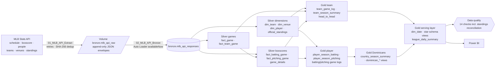
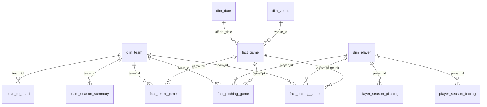

# Data Model & Architecture

## 1. Medallion layers



| Layer | Objects | Write pattern |
|---|---|---|
| Landing | `/Volumes/mlb_intelligence/bronze/mlb_api_raw/<endpoint>/<yyyy>/<mm>/<key>__<timestamp>.json` | Append-only files; unchanged responses not landed |
| Bronze | `bronze.mlb_api_responses` | Auto Loader append, one row per file, payload as raw JSON |
| Silver | dimensions and facts | `MERGE` upserts; facts processed incrementally from a watermark on `_ingested_at` |
| Gold | KPI tables and views | Full recompute from Silver each run (small, always consistent) |
| Metadata | `pipeline_runs`, `extract_register`, `watermarks` | Append / MERGE |
| Quality | `dq_results` | Append per run |

## 2. Star schema (Gold serving layer)



## 3. Table catalogue

### Silver

| Table | Key | Main columns |
|---|---|---|
| `dim_team` | `team_id` | name, abbreviation, league (AL/NL), division, home venue |
| `dim_venue` | `venue_id` | name, city, state, country, latitude, longitude, elevation |
| `dim_player` | `player_id` | name, birth date/city/country, `is_dominican`, height, weight, position, bats, throws, debut, current team |
| `official_standings` | `season, team_id` | official W, L, RS, RA, ranks, games back, clinch (reconciliation only) |
| `fact_game` | `game_pk` | season, game type, date, status, `is_completed`, `was_rescheduled`, scores, hits, errors, LOB, innings, winner/loser team, W/L/SV pitchers, extra innings, one-run game, series info |
| `fact_team_game` | `game_pk, team_id` | opponent, home/away, runs scored/allowed, hits, errors, win/loss, run differential |
| `fact_batting_game` | `game_pk, player_id` | team, opponent, lineup slot, starter, position, PA, AB, R, H, 1B, 2B, 3B, HR, RBI, BB, IBB, SO, HBP, SB, CS, SF, SH, TB, LOB, GIDP |
| `fact_pitching_game` | `game_pk, player_id` | appearance order, starter, outs, IP, BF, pitches, strikes, H, R, ER, BB, SO, HR, HBP, W, L, SV, HLD, BS, quality start, decision |
| `game_details` | `game_pk` | attendance, duration, weather, wind, first pitch, home-plate umpire |

### Gold

| Object | Grain | Notes |
|---|---|---|
| `team_game_log` | team × game | running record, run differential, last-10, streak |
| `team_season_summary` | team × season × season type | KPIs TEAM-001…013 + official ranks |
| `head_to_head` | team × opponent × season × season type | KPIs H2H-001…004 |
| `player_season_batting` | player × season × season type | KPIs BAT-001…010 |
| `player_season_pitching` | player × season × season type | KPIs PIT-001…010 |
| `batting_game_log`, `pitching_game_log` | player × game | KPIs FORM-001…003 |
| `country_season_summary` | country × season × season type | KPIs DR-001…004 |
| `latest_game_day_lines` | view | every player's line on the latest game day, with birth country (DR-007) |
| `dominican_batting_season`, `dominican_pitching_season`, `dominican_latest_games` | views | KPIs DR-005, DR-006 |
| `dim_date`, `dim_team`, `dim_player`, `dim_venue`, `fact_*` | serving views / table | star schema for Power BI |
| `league_daily_summary` | date × season type | KPIs LG-001…004 |
| `game_features` | game (completed and upcoming) | point-in-time pre-game features, home − away |
| `game_predictions` | game | home win probability, predicted winner, correctness, top factors, split (train / test / upcoming) |
| `win_model_metrics`, `win_model_calibration`, `win_model_features` | model run | evaluation, calibration and drivers of the win-probability model |

## 4. Incremental strategy

1. **Extraction** skips work already done: boxscores of completed games already in `metadata.extract_register`, players already in `dim_player`, venues already in `dim_venue`. Every response is hashed; identical content is registered as `UNCHANGED` and not landed.
2. **Bronze** uses Auto Loader with a checkpoint, so each landed file is ingested exactly once.
3. **Silver facts** read only Bronze rows with `_ingested_at` greater than the consumer's watermark, take the latest payload per request and `MERGE` by business key. Setting `full_refresh = true` reprocesses all history (e.g. after adding a column).
4. **Gold** is recomputed from Silver on every run.

## 5. Orchestration — `resources/jobs/mlb_performance_daily.job.json`

```
extract_mlb_api → bronze_ingest ─┬→ silver_dimensions ───────────────┐
                                 └→ silver_games → silver_boxscores ─┼→ gold_team_metrics ──────────────┐
                                                                     └→ gold_player_metrics → gold_dominican_players ─┴→ gold_semantic_layer → gold_game_features → ml_win_probability → data_quality → web_platform_export
```

Daily at 06:07 (America/Santo_Domingo). Job parameters (`mode`, `seasons`, `start_date`, `end_date`,
`lookback_days`, `refresh_people`, `full_refresh`) reach every notebook as widget values, so a backfill
is just *Run now with different parameters* → `mode = backfill`.
